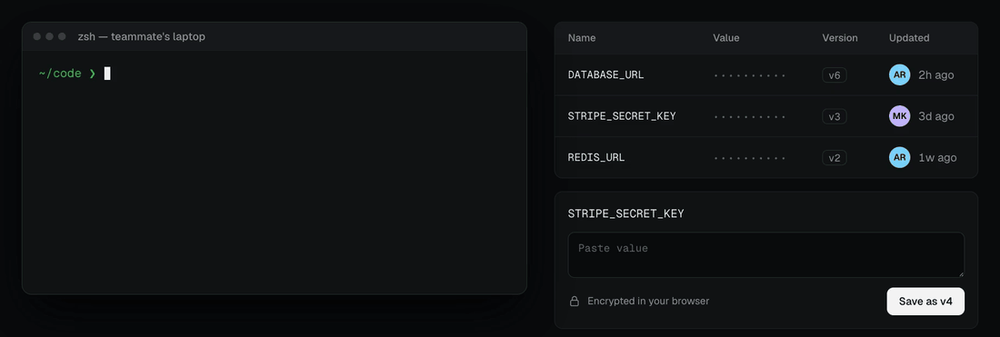
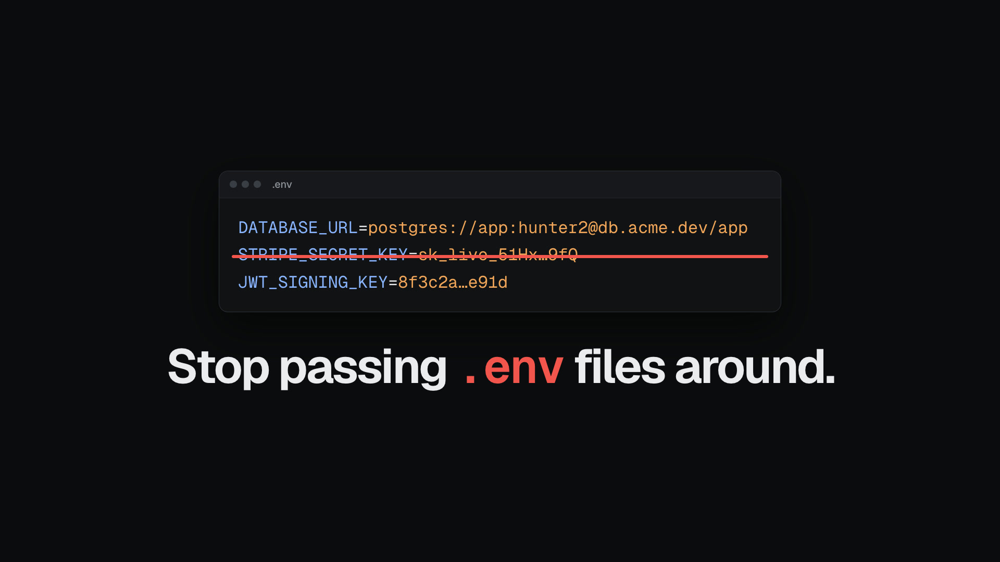

<h1 align="center">noenv</h1>

<p align="center">
  <b>Stop passing <code>.env</code> files around.</b><br>
  Encrypted environment variables that load when you <code>cd</code> into a repo and unload when you leave.<br>
  Self-hosted on your own Cloudflare account.
</p>

<p align="center">
  <a href="https://noenv.thisisamank.in">Website</a> ·
  <a href="https://noenv.thisisamank.in/assets/tour.mp4">40-second demo</a> ·
  <a href="https://www.npmjs.com/package/noenv-cli">npm</a>
</p>

<p align="center">
  
</p>

<p align="center">
  <a href="https://deploy.workers.cloudflare.com/?url=https://github.com/thisisamank/noenv"></a>
</p>

```console
$ npm install -g noenv-cli
$ cd ~/code/backend
noenv: loaded 12 secrets for github.com/acme/backend (development)
$ npm run dev        # your app sees DATABASE_URL, STRIPE_KEY, …
$ cd ..              # and they are gone again
```

## Demo

[](https://noenv.thisisamank.in/assets/tour.mp4)

Deploy, create a passkey, install the CLI, approve your terminal, and move your `.env` files in, in 40 seconds.

## What it does

- **Loads secrets by repository.** The git `origin` is the project. There is nothing to configure per repo.
- **Encrypts on your machine.** Values are encrypted before they leave your laptop. The server only ever stores ciphertext.
- **Updates live.** A secret saved in the CLI, in the dashboard, or by a teammate shows up at your next prompt.
- **Keeps every version.** Each change is a new version, and rollback is one click.
- **Replaces `.env` files.** Admins can warn about, block, or migrate and delete `.env` files on team machines.
- **Runs on your own Cloudflare account.** One Worker, one D1 database, and one KV namespace. No third party sees your data.

## Get started

**1. Deploy.** Click the button above and enter your email as `ADMIN_EMAIL`.

**2. Create your admin passkey.** Open `https://<your-worker>.workers.dev/dashboard/` and sign up with the same email. If [invitation emails](#invitation-emails) are on, the dashboard emails you a setup link instead. Passkeys use Touch ID, Face ID, or a security key. There are no passwords.

**3. Install the CLI.** It needs Node.js 22 or newer.

```sh
npm install -g noenv-cli
```

**4. Connect your shell.** Add these lines to `~/.zshrc` or `~/.bashrc`. The dashboard shows them with your URL filled in.

```sh
export NOENV_URL="https://<your-worker>.workers.dev"
eval "$(noenv shell zsh)"   # or: noenv shell bash
```

Open a new terminal and `cd` into a repo. Your browser opens once so you can approve the terminal with your passkey.

**5. Add a project.**

```sh
cd ~/code/backend
noenv init                  # creates the project and a development environment
noenv secret set API_KEY    # prompts for the value and keeps it off screen
```

## Everyday use

| Command | What it does |
|---|---|
| `noenv status` | Show the deployment, your account, and the current project |
| `noenv secret set KEY` | Save a secret (a new version) |
| `noenv secret list` | List the secrets in this environment |
| `noenv secret history KEY` | List the versions of a secret |
| `noenv secret rollback KEY VERSION` | Restore an older version |
| `noenv migrate` | Move this repo's `.env` files into noenv |
| `noenv grant EMAIL ROLE` | Give someone access to this project and share the key |

Set the environment with `environment = "staging"` in a `.noenv` file in the repo, or with `NOENV_ENVIRONMENT=staging` for one shell.

The dashboard does the rest: projects, secrets and history, team invites, policies, and devices.

## Team

1. Invite people from **Team** or from a project's **Members** card. You get a link to send them.
2. They open the link and create a passkey.
3. They connect their shell as in step 4 above.
4. Run `noenv grant their@email.com editor` to share the environment key.

Roles: **reader** loads secrets, **editor** also writes them, **admin** also manages members and policies.

### Invitation emails

noenv can email invites and the first admin's setup link through [Cloudflare Email Sending](https://developers.cloudflare.com/email-service/). Without it, the dashboard and `noenv invite` give you the link to send yourself.

1. Onboard your domain: `npx wrangler email sending enable example.com`
2. Set the sender address, on that domain: `npx wrangler secret put EMAIL_FROM` (for example `noenv@example.com`)

The `EMAIL` binding is already in `wrangler.jsonc`. When email is on, the first admin gets the setup link by email, so only someone with access to `ADMIN_EMAIL` can claim the deployment.

## How it works

- Each environment has its own key pair. Secrets are sealed to the environment's public key, so anyone with write access can add a value without being able to read the others.
- Each member gets the environment's private key wrapped for their own key, which lives in `~/.config/noenv`.
- The Worker checks who you are and what role you have before it returns anything. It never sees a plaintext value.
- The newest values come from KV in one read. D1 holds every version, the permissions, and the policies.

It protects against secrets leaking through `.env` files, chat, and repositories. It does not stop someone with access from reading the variables in their own shell.

## Develop

```sh
npm install
npm test             # unit and integration tests
npm run typecheck
npm run setup -- --admin you@example.com   # deploy from this checkout with your wrangler login
npm run build -w noenv-cli && cd cli && npm link   # use the local CLI instead of the npm one
```

The code is split into `packages/` (shared libraries), `worker/` (the API), `cli/`, and `dashboard/`. See [spec.md](spec.md) for the full design.
